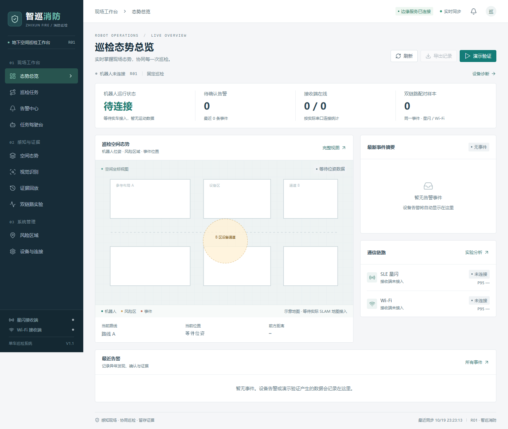
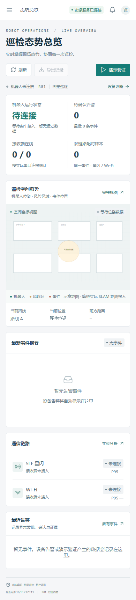

# 智巡消防 · 网站与 APP 重构交付说明

日期：2026-10-19。网站和 HarmonyOS 应用版本为 1.1.0，边缘服务的版本字段沿用原值。本轮在原工程内改进界面、数据连接和使用流程，不改变设备协议及控制 API 的枚举名称。

## 可以直接使用的内容

网站访问 http://127.0.0.1:5173/ 。边缘服务默认使用 http://127.0.0.1:8787/ 。本轮本机预览读取既有的 `edge-service/data/live-httpbridge.db`，没有向该库写入 QA 演示事件，也没有自动启用串口或 ROS。

新版原生 APP 文件为 `harmony-app/release/ZhiXunFire_1.1.0_debug_unsigned.hap`。它是未签名调试包；真机安装须在 DevEco Studio 配置对应签名。原有 1.0 包保留。构建命令、包校验值与原生能力限制见 `harmony-app/VALIDATION.md`。

网站标题、导航品牌、APP 显示名称、服务 API 文档标题与本轮交付文件统一使用“智巡消防”。应用标识、协议枚举、数据库路径和已有配对存储键沿用原值，支持原工程与连接配置继续使用。

修改前备份保存在 `C:/Users/q4984/AppData/Local/Temp/starshield-refactor-92f8918f/`，其中有网站、APP 和服务的压缩副本。原有硬件资料与项目文档没有改写。

## 功能变化

| 模块 | 本轮行为 |
| --- | --- |
| 统一界面 | 深蓝导航、暖白内容、青绿主操作与橙红风险提示；页面标题、表格、空状态、反馈、表单和弹窗统一。网站适配桌面与手机。 |
| 状态总览 | 区分边缘服务、推送链路、ROS 机器人和串口接收端。没有实测数据的延时、板端状态和运动状态显示未知或待连接。 |
| 告警中心 | 读取 SQLite 历史，按关键词、等级和确认状态筛选；网站每页 12 条，最多加载最近 200 条；APP 可继续请求历史分页。 |
| 人工确认 | 将确认写入数据库并广播给在线客户端。查看详情后可确认和重试；刷新或服务重启后仍保留确认记录。确认表示知悉，不清除风险或解除急停。 |
| 证据与导出 | 查看服务保存的原始事件和链路证据；网站支持事件 CSV、证据 JSON、回放 JSON 与设备诊断 JSON 导出。 |
| 证据回放 | 按事件读取真实保存帧；显示位置及帧内容，提供滑块和播放。单帧禁止播放，空回放明确提示，不补造帧。APP 支持逐帧查看。 |
| 风险区域 | 网站支持新增和编辑名称、坐标、半径与风险级别，地图同步变化。表单校验数值范围；当前配置在服务重启后需重新设置。 |
| 任务驾驶台 | 保留固定巡检、手动控制、智能任务三种模式。原接口仍使用 LOBSTER_AI；显示文字改为“智能任务”。操作等待服务响应，并防止重复提交。 |
| 语音与安全 | 网站先转录到文本，需点击下达任务；APP 保留原生识别、播报及权限处理。机器人未连接时禁用手动运动，暂停和急停结果来自服务端。 |
| 设备诊断 | 展示五板角色、实际接收串口、累计帧、校验错误、ROS、视觉模型和连接异常，支持修改服务地址。 |
| APP 配对与连接 | 保留扫码与手动配对；补充返回、取消配对、重连、失效令牌与旧请求隔离，断线自动重试；失败不伪造成功。 |

## 前端组织

网站将共享类型、请求处理、数据订阅和页面拆开，避免每个页面各自维护一套状态。

| 文件 | 职责 |
| --- | --- |
| `web-console/src/api.ts` | 请求超时、HTTP 错误、服务地址校验、CSV 转义与文件导出。 |
| `web-console/src/useEdge.ts` | 并行快照读取、5 秒轮询、页面可见性处理、WebSocket 重连，以及旧请求 / 确认状态合并。 |
| `web-console/src/components.tsx` | 统一状态、数据格式、信息卡、空状态与原生 dialog。 |
| `web-console/src/App.tsx` | 导航、URL hash、操作反馈及跨页面协调。 |
| `web-console/src/EventsPage.tsx` | 事件检索、分页、证据详情、人工确认及导出。 |
| `web-console/src/AdvancedViews.tsx` | 空间态势、区域、视觉服务与历史回放。 |
| `web-console/src/OperationsPages.tsx` / `ControlPage.tsx` | 巡检、设备诊断、连接配置、模式与任务操作。 |
| `harmony-app/entry/src/main/ets/store/AppStore.ets` | 原生页面状态、历史读取、确认、安全操作及连接生命周期。 |
| `harmony-app/entry/src/main/ets/services/edge/` | 原生 HTTP、WebSocket、事件路由及档案合并。 |

HTTP 与推送并行运行。每类状态单独记录推送修订，较新推送只替代同类的旧读取，系统快照不会丢弃首屏的控制模式与空间数据；已经保存的确认不会被迟到的未确认事件撤回。切换服务会重置页面上下文，原服务迟到的操作结果不会写入当前服务的详情和任务反馈。

## 新增服务契约

| 接口 / 消息 | 用途 |
| --- | --- |
| `GET /api/v1/events?limit=200&offset=0` | 返回按创建时间倒序的事件数组；limit 为 1～1000，offset 非负。 |
| `POST /api/v1/alerts/{event_id}/ack` | 幂等确认并返回完整更新事件。未知事件返回 404。 |
| `alert.updated` | WebSocket 广播完整更新事件，以便跨页面、跨端同步确认。 |
| `twin.snapshot` | 确认或区域修改后同步空间态势数据。 |

数据库保留原始事件证据；重复传输不会覆盖已确认状态。服务启动时回填最新 1000 条到态势内存；较早记录仍可通过历史分页与证据接口访问。具体迁移和接口说明见 `edge-service/README.md`。

## 验证记录

| 检查 | 结果与范围 |
| --- | --- |
| 网站生产构建 | `npm run build` 通过，包含 TypeScript 检查和 Vite 构建。 |
| 网站主要流程 | 浏览器逐页打开十个页面；验证确认、刷新后确认保留、关键词 / 等级筛选、CSV / 证据 / 回放 / 诊断下载，以及区域新增 / 编辑与非法半径校验。 |
| 异常与同步 | 在隔离 QA 服务上拦截确认请求并返回 503，页面提示失败、允许重试，数据库未被确认；恢复后完成确认，第二个页面同步更新。健康检查失败后显示离线并禁用远程操作，恢复后重新连接。 |
| 首屏并发回归 | 延迟控制快照，确保 WebSocket 系统快照先到达；复现首屏漏掉模式的问题后修复，并验证第一次加载即显示正确模式，无需等待下次轮询。 |
| 手机布局 | 320×844 和 390×844 两种宽度下检查总览、告警、驾驶台、回放、区域、诊断，页面宽度均无横向溢出；检查导航收起后不遮挡内容。 |
| 网站运行错误 | 上述浏览器流程没有 JavaScript 页面异常；故意注入的两次 503 会产生预期的网络错误日志。 |
| 服务回归 | 80 项通过；测试使用临时 SQLite 与日志路径。 |
| APP 构建与逻辑 | 核心改动经 Hypium 15 项、状态层宿主回归 23 项验证；后续状态显示及更名补丁重新 assembleHap 通过。完整记录见 APP 验证文档。 |
| 本机预览 | 网站根页面、网站代理健康检查和边缘健康接口均返回 HTTP 200。 |

浏览器写操作使用独立测试库，硬件串口和 ROS 均关闭。没有在验证过程中自动驱动小车、解除急停或调用真实灭火装置。

## 页面截图

下列为本机新版网站的实际截图；手机截图是响应式网站，并非鸿蒙 APP 运行截图。





## 当前边界

- 本轮完善现有系统的数据展示、交互及告警流程。地图背景为明确标注的参考布局，真实 SLAM 底图仍需接入，机器人位姿来自实际遥测。
- 视觉页展示模型加载状态、服务信息和既有连续帧规则。服务目前没有网页视频流；模型预处理、后处理与摄像头实时推理仍取决于独立视觉管线，不把演示事件当成真实检测。
- 网站仅对当前载入的最近 200 条记录筛选 / 导出；APP 支持继续加载。区域和轨迹目前不做服务重启持久化。
- 2026-10-20 已恢复 DevEco 的 entry 模块并通过 IDE 构建、安装和启动新版 APP；使用现有空闲的 Enjoy 90 Pro Max，实际配对页截图及前台进程证据见 `harmony-app/release/runtime-20261020/`。原 Enjoy 90 Pro Max 001 曾因空间不足安装失败，其数据保留。扫码、麦克风、现场硬件与其余页面仍需各自验证。
- 当前交付 HAP 未签名；使用支持相应 CoreSpeechKit / AudioKit / ScanKit 的设备完成原生能力验证后，再签名分发。

## 以后启动

本机预览分别在两个 PowerShell 窗口运行：

```powershell
cd D:\table\ros_car\xuanxun-starshield\edge-service
$env:EDGE_ROS_ENABLE = '0'
$env:STARSHIELD_SERIAL_PORTS = ''
$env:ROS_BRIDGE_URL = ''
$env:EDGE_DB_PATH = 'data/live-httpbridge.db'
$env:EDGE_RAW_LOG_PATH = 'data/live-httpbridge.jsonl'
.\.venv\Scripts\python.exe -m uvicorn fire_edge.app:app --host 127.0.0.1 --port 8787
```

```powershell
cd D:\table\ros_car\xuanxun-starshield\web-console
npm run dev -- --host 127.0.0.1 --port 5173
```

如果需要按既有配置连接硬件与局域网，使用项目根目录的 `start_xuanxun_starshield.bat`，并按实际接线检查脚本内串口号。该脚本会保留已经占用端口的现有服务；切换运行配置前应先结束此前启动的窗口。
